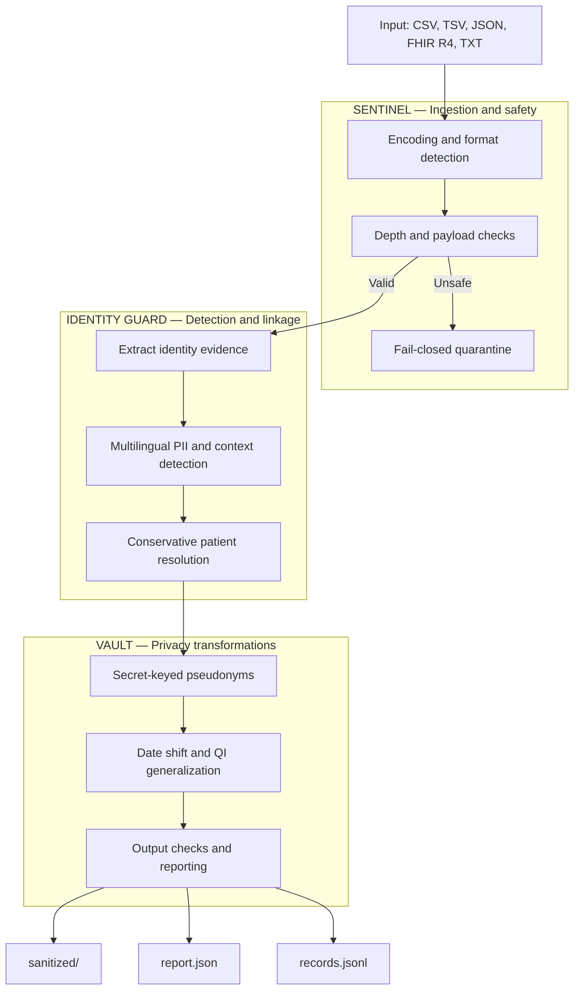

# RAKSHA --- Track 3: Secret Wards

**Adversarial Re-identification Resistance with Clinical-Utility Preservation**  
**Yugaantar DevForge 2026 · Track 3: Secret Wards**  
*What happens in the ward stays in the ward.*

> RAKSHA is an offline, CPU-only, LLM-free privacy firewall for synthetic Indian hospital records. It is designed to remove personal information across English, Hindi and Hinglish; preserve medically useful values; link the same patient across files and hospitals without unsafe merges; and reduce re-identification risk from quasi-identifiers and hidden data channels.

## 1. The Track 3 Problem

Track 3, **Secret Wards**, covers privacy engineering, multilingual information extraction, record linkage and data security. The organizers provide synthetic records from four hospital systems in English, Hindi and Hinglish, alongside a hidden attacker that attempts to identify patients from sanitized outputs. No real patient data is used.

The challenge is not simply to remove names. A submission must:
- remove personal information from structured fields and free text;
- preserve medically useful values exactly;
- recognize the same patient across languages, files and hospitals without merging different people;
- reduce re-identification risk from quasi-identifiers and outside background knowledge; and
- prevent leakage through outputs, logs, temporary files and error messages.

An attacker may know a patient's approximate age, village, diagnosis, visit date or length of stay. A record can remain identifiable even after direct names and phone numbers are removed.

## 2. Challenge-to-Solution Mapping

| Secret Wards requirement | RAKSHA approach |
|---|---|
| English, Hindi and Hinglish PII | Script-aware rules, name/identifier patterns, Devanagari--Latin normalization and contextual detection |
| Indian names, aliases and kinship references | Name normalization, transliteration, phonetic blocking and relationship-context rules |
| Meaning-sensitive redaction | Context rules distinguish relatives from complaints, clinicians from patients, and medical values from identifiers |
| Cross-file and cross-hospital identity | Evidence-based record linkage and stable secret-keyed HMAC pseudonyms |
| Quasi-identifier risk | Per-patient date shifting, age bands, location generalization and PIN-prefix masking |
| Hidden leakage channels | Scanning/sanitization of content, filenames, headers, JSON keys, metadata and supported encoded attachments |
| Malformed or unsupported files | Fail-closed quarantine instead of copying uncertain input into sanitized output |
| Reproducibility and security | Environment-provided secret, deterministic transformations and PII-conscious logging |

## 3. The Six Challenge Traps

### Language trap
Names appear in English, Devanagari and Hinglish, with spelling variants, initials, honorifics and different name orders. RAKSHA uses normalization and cross-script comparison to support detection and linkage.

### Meaning trap
The same token can mean different things in context. `C/O Ramesh` may identify a relative, while `C/O fever` is a complaint. Clinician credentials, diagnoses, medicines and dosage expressions must not be mistaken for patient identifiers.

### Fragmented identity trap
A patient may appear in multiple hospitals and formats with different identifiers or partial demographics. RAKSHA uses corroborating evidence and conservative clustering. If evidence is insufficient or conflicting, the safe outcome is `patient: null`, not a speculative merge.

### Re-identification trap
Age, village, PIN code, exact dates, length of stay and rare diagnoses can identify a person in combination. RAKSHA applies generalization and per-patient date shifting. These reduce linkage clues but do not prove that every possible attacker is defeated.

### Clinical integrity trap
Medicines, doses, frequencies, vitals, lab values, diagnoses, procedures and stay intervals must survive. A uniform patient-level date shift is intended to preserve interval lengths.

### Hidden leakage trap
Personal data may appear in filenames, CSV headers, JSON keys, metadata and attachments. RAKSHA sanitizes supported channels and quarantines inputs it cannot safely process.

## 4. Architecture: SENTINEL, IDENTITY GUARD and VAULT



- **SENTINEL:** file discovery, encoding/format checks and safe quarantine.
- **IDENTITY GUARD:** personal-data detection and evidence-based identity resolution.
- **VAULT:** keyed pseudonymization, privacy transformations and output reporting.

## 5. Required Submission Contract

The organizer requires these items inside the output directory:

```text
output/
├── sanitized/
├── report.json
└── records.jsonl
```

- `sanitized/`: cleaned files, retaining supported formats and directory structure. Unsafe or unsupported files must not be copied through as clean.
- `report.json`: file accounting, SHA-256 input identifiers, processing status, counts and resource information. Reported values must be truthful.
- `records.jsonl`: maps each record locator to its stable pseudonymous patient ID. Ambiguous identity is represented as `null`.

## 6. Run and Verify

```bash
pip install -r requirements.txt
export RAKSHA_SECRET="practice"  # PowerShell uses $env:RAKSHA_SECRET

python main.py --input dev/input --output output
python validate_output.py --input dev/input --output output
python check_dev.py --output output --truth dev/truth/truth.json
python check_submission.py --repo . --run
```

Evaluation is offline, CPU-only and LLM-free. The organizer specifies 2 CPUs, 4 GB RAM and a 15-minute run limit. Hidden datasets include unseen names, labels and formats; practice-set results do not guarantee hidden-set performance.

## 7. Measured Practice-Set Results

The following figures are reported in the repository's final validation documentation for the 200-file practice set. They are not official hidden-dataset scores.

| Metric | Reported result |
|---|---|
| PII leakage | 0 / 3,230 (0.0%) |
| Canary leakage | 0 / 4 |
| Medical values preserved | 4,855 / 4,855 (100.0%) |
| Identity linkage | Precision 1.00 · Recall 1.00 · F0.5 1.00 |
| Wrong patient merges | 0 |
| File accounting | 192 sanitized + 8 quarantined = 200 |
| Raw copies | 0 |
| Output contract | `CONTRACT OK` |
| Pre-submission audit | `READY TO SUBMIT` |
| Automated tests | 199 passed |
| Runtime / peak memory | 6.64 s / 31.0 MB |

**Evaluation boundary:** The organizer's `raksha_eval` package is not bundled locally. Exact official A1--A7 attack probabilities and B³ F1 are **not evaluated locally**. Do not present practice-set checks as official hidden-attacker results.

## 8. Privacy--Utility Trade-off

RAKSHA reduces selected demographic and temporal precision to make linkage harder while retaining clinical information. Reported transformations include five-year age bands, village-to-district generalization, three-digit PIN prefixes and per-patient date shifts. The intended benefit is to preserve medically meaningful values and length-of-stay intervals while reducing the usefulness of quasi-identifiers to an attacker.

Broader age and location categories reduce research granularity; retaining too much detail can expose patients. The balance must be measured against the organizer's attacker and utility checks.

## 9. Security Design and Limitations

- `RAKSHA_SECRET` must not be committed, logged or written into reports.
- HMAC-SHA256 uses separate purpose prefixes for pseudonym, date-shift and filename-tag derivations.
- Runtime network calls are not permitted by the competition.
- Unsafe or unsupported inputs should be quarantined, not silently passed through.
- **Adaptive record-level k-anonymity widening/suppression is not actively enforced in the current sanitized export.** Do not describe it as an active export guarantee.
- Exact official A1--A7 attack scores and B³ F1 remain unverified locally.
- Unseen regional names, unfamiliar identifiers and novel file structures may reduce detection or linkage quality. Ambiguous records should remain unlinked rather than risk a false merge.

## 10. Alignment with the Scoring Rubric

The rubric assigns 25 points to privacy against attacks, 20 to personal-data detection, 20 to medical-data preservation, 15 to identity consistency, 10 to output quality/validity, and 10 to speed/reliability. RAKSHA is organized around all six dimensions rather than treating name removal as the whole problem.

**Project positioning:** RAKSHA targets **Adversarial Re-identification Resistance with Clinical-Utility Preservation**---protect patient identity without destroying the clinical value of the records.

**Repository:** https://github.com/30sharathkumar-ux/Med-sec  
**Track:** Yugaantar DevForge 2026 --- Track 3: Secret Wards
