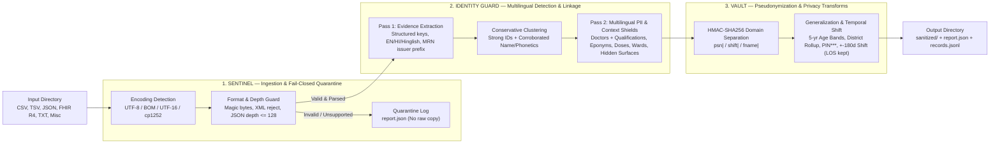

# RAKSHA: Offline Multilingual Medical Data Privacy Firewall

**Adversarial Re-identification Resistance with Clinical-Utility Preservation**  
*Yugaantar DevForge 2026 · Track 3: Secret Wards*

---

## 1. Problem Statement

Hospital networks aggregating heterogeneous patient encounters for public-health research face a three-way conflict:
1. **Multilingual & Hidden PII:** Patient identifiers appear across English, Devanagari Hindi, and Hinglish free text, as well as hidden channels—filenames, CSV headers, JSON dictionary keys, export metadata paths, and Base64-encoded attachments.
2. **Clinical Utility Destruction:** Naive redaction strips medications, dosages (`1-0-1`, `BD x 5 days`), eponyms (`Parkinson's disease`), and clinician credentials (`Dr. Anil Kumar MD Cardiology`), rendering datasets clinically unusable.
3. **Adversarial Re-identification & Fragmented Records:** Even when names are masked, adversaries armed with population registries and partial encounter facts can re-identify patients via quasi-identifiers (exact age, village, PIN, unshifted dates) or exploit fragmented cross-hospital records.

## 2. Track Alignment

RAKSHA is engineered specifically for **Yugaantar DevForge 2026 — Track 3: Secret Wards**, operating strictly **offline**, **CPU-only**, and **LLM-free** within the competition's `2 CPU / 4 GB RAM / 15-minute` envelope while enforcing the `raksha-report/1` and `records.jsonl` output contracts.

## 3. Unique Selling Proposition (USP) & Why RAKSHA Is Different

- **Zero-LLM, Sub-7s Deterministic Pipeline:** Pure algorithmic rules, Devanagari–Latin transliteration, phonetic blocking, and HMAC-SHA256 run in `~6.6s` (`~31 MB` peak RSS) with byte-for-byte determinism under the same `RAKSHA_SECRET`.
- **Context-First Medical Preservation:** Distinguishes `Dr. Ramesh Srivastava (MD Medicine)` and `Dr. Anil Kumar MD Cardiology` from genuine patient names like `Md. Shahid`, `C/O fever` (complaint) from `C/O Ramesh` (relative), and `Ward 5 (Medicine)` from residential `Ward 10`.
- **Precision-First Cross-Hospital Linkage:** Achieves `1.00` precision and `1.00` recall (`F0.5 = 1.00`, `0` wrong merges) on the practice dataset using dynamic MRN issuer-prefix extraction (`[A-Z]{2,6}[-/]`) with zero hardcoded hospital aliases.

## 4. Architecture Overview: SENTINEL, IDENTITY GUARD & VAULT



*(Diagram source: [docs/architecture.mmd](docs/architecture.mmd))*

| Layer | Modules | Core Responsibility |
|---|---|---|
| **SENTINEL** | `encoding.py`, `ingestion.py`, `processors/quarantine.py`, `privacy/fhir_validator.py` | Multi-encoding decoding, magic-byte/XML checks, iterative JSON depth bounding (`<= 128`), FHIR R4 structural validation, fail-closed quarantine |
| **IDENTITY GUARD** | `detection/*` (`names.py`, `identifiers.py`, `addresses.py`, `context_rules.py`, `hidden_surfaces.py`, `multilingual.py`, `structured.py`), `linkage/*` (`resolver.py`, `normalize.py`) | Multilingual PII span detection, hidden-channel scrubbing, Devanagari transliteration, phonetic blocking, conservative Union-Find clustering |
| **VAULT** | `privacy/pseudonymize.py`, `privacy/transforms.py`, `privacy/k_anonymity.py`, `reporting/*`, `security/logging.py` | Domain-separated HMAC-SHA256 pseudonyms (`PSN-XXXXXX`), per-patient date shifts (`±180d`), 5-year age bands, village→district & PIN prefix generalization, contract reporting |

## 5. End-to-End Data Flow

1. **Pass 1 (Ingest & Resolve):** Discover files deterministically; decode UTF-8/BOM/UTF-16/cp1252; quarantine malformed/unsupported payloads; extract patient evidence across CSV/TSV, JSON, FHIR R4 `Bundle`, and text; resolve clusters using strong IDs (with phonetic collision guards and dynamic MRN issuer prefixes) and corroborated name/demographic clues.
2. **Pass 2 (Sanitize, Transform & Export):** Scrub PII-bearing filenames (`fname|`), CSV headers, JSON keys, metadata paths, Base64 payloads, and free text; inject deterministic `PSN-XXXXXX` (`psn|`) pseudonyms; apply per-patient date shifts (`shift|`), age banding, and location generalization; emit `sanitized/`, `records.jsonl`, and `report.json`.

## 6. Supported Inputs & Outputs

| Inputs | Outputs |
|---|---|
| `.csv`, `.tsv` (UTF-8, UTF-8 BOM, UTF-16, cp1252), `.json` (flat/nested), FHIR R4 `Bundle` `.json`, `.txt` clinical notes & WhatsApp forwards | `sanitized/` (clean directory mirror), `records.jsonl` (RFC 6901 JSON pointers & `PSN-XXXXXX` links), `report.json` (`raksha-report/1` counts, entities, timing, RSS, quarantine reasons) |
| Unsupported/corrupt inputs (PDF, images, XML CDA, binary, depth `> 128`, empty, format-mismatched) | Safely quarantined in `report.json`; **never** copied raw to `sanitized/` |

## 7. Multilingual PII Detection & Medical Preservation

- **Identifiers:** 12-digit & masked Aadhaar, 14-digit ABHA numbers & ABHA addresses, Indian mobile numbers (`+91`, `0`, Devanagari digits), PAN, email, insurance IDs, and institutional MRN/UHIDs.
- **Names & Relatives:** English, Devanagari (`राम`, `सीता`), and Hinglish (`Mohd.`, `Md.`, `मोहम्मद`) names with honorifics (`ji`, `sahab`, `didi`) and kinship frames (`S/o`, `D/o`, `W/o`, `पत्नी`, `बेटा`).
- **Clinical Preservation Shields (`context_rules.py`):** Preserves clinician names and qualifications (`Dr. Ramesh Srivastava (MD Medicine)`, `Dr. Anil Kumar MD Cardiology`, `Dr. Anil Kumar, MD, Cardiology`), eponyms (`Parkinson's disease`, `Addison's disease`), medications & doses (`Ramipril 5mg`, `Dolo 650 BD x 5 days`, `1-0-1`), hospital wards (`Ward 9 (Medicine)`), and complaint markers (`C/O fever`, `K/C/O`, `H/O`).

## 8. Identity Resolution & Pseudonymization

- **Conservative Clustering (`resolver.py`):** Merges on strong identifiers (Phone, Aadhaar, ABHA, Email, PAN, Insurance ID, and hospital-scoped MRN via dynamic `extract_issuer_prefix()`) guarded against shared facility IDs and demographic conflicts. Name-based merges require corroboration (relative name, DOB/derived age, village+age, or masked Aadhaar).
- **Cryptographic Domain Separation (`pseudonymize.py`, `transforms.py`, `hidden_surfaces.py`):**
  - Pseudonyms: `HMAC-SHA256(RAKSHA_SECRET, b"psn|" + patient_key)` → Crockford base32 `PSN-XXXXXX`
  - Date shifts: `HMAC-SHA256(RAKSHA_SECRET, b"shift|" + patient_key)` → non-zero offset in `[-180, +180]` days
  - Filenames: `HMAC-SHA256(RAKSHA_SECRET, b"fname|" + rel_path)` → `doc_<hex10><ext>`

## 9. Privacy, Threat Model & Security Design

- **Quasi-Identifier Generalization:** 5-year truthful age bands (`45-49`), village → district rollup, 6-digit PIN → 3-digit prefix (`229***`), house/landmark suppression, and per-patient secret date shifting (preserving exact Length of Stay).
- **Side-Channel Hygiene:** `RAKSHA_SECRET` is read solely from the environment, never cached or logged; stdout emits aggregate counts only; zero `tempfile` usage; all processing runs in memory.

## 10. Installation, Configuration & Execution

```bash
# 1. Install offline-compatible dependencies (Python 3.10+, CPU-only)
pip install -r requirements.txt

# 2. Run pipeline (offline, no network required)
export RAKSHA_SECRET="practice"   # PowerShell: $env:RAKSHA_SECRET="practice"
python main.py --input dev/input --output output
```

Configuration lives in `config/policy.yaml` (`age_band_years: 5`, `date_shift_max_days: 180`, `min_group_size: 5`, `max_json_depth: 128`, `max_file_bytes: 52428800`).

## 11. Testing & Evaluation Commands

```bash
# Unit, adversarial, and regression test suite
RAKSHA_SECRET=practice python -m pytest tests/ -q

# Official output contract validation
python validate_output.py --input dev/input --output output

# Official practice self-check against dev/truth/truth.json
python check_dev.py --output output --truth dev/truth/truth.json

# Official pre-submission compliance audit (Linux)
python3 check_submission.py --repo . --run
```

## 12. Verified Benchmark Results (`dev/input`, 200 Files)

All metrics below are from direct execution after the final code edit (see `FINAL_VALIDATION_REPORT.md`):

| Metric | Source | Measured Result |
|---|---|---|
| **PII Leakage** | Official `check_dev.py` | **0 / 3,230 (`0.0%`)** (`latin 0.0%`, `deva 0.0%`, `hinglish 0.0%`, all 6 channels `0.0%`) |
| **Canary Leakage** | Official `check_dev.py` | **0 / 4** (`0` leaks across content, filenames, logs, `report.json`) |
| **Medical Preservation** | Official `check_dev.py` | **4,855 / 4,855 (`100.0%`)** |
| **Identity Linkage** | Official `check_dev.py` | **Precision `1.00`, Recall `1.00`, F0.5 `1.00`**, `0` wrong merges |
| **Raw Copies / Quarantine** | Official `check_dev.py` & `report.json` | **`0` raw copies** (`192` sanitized + `8` quarantined = `200/200`) |
| **Output Contract** | Official `validate_output.py` | **`CONTRACT OK`** |
| **Pre-Submit Audit** | Official `check_submission.py --repo . --run` | **`READY TO SUBMIT`** (deterministic, secret-keyed) |
| **Test Suite** | Local `pytest tests/` | **`199 passed in 10.47s`** |
| **Runtime & Memory** | `report.json` (Windows) / WSL2 2-CPU (`taskset -c 0,1`) | **`6.64s` / `31.0 MB` peak RSS** (limit `900s` / `4,096 MB`) |
| **Official A1–A7 & B³ F1** | Official `raksha_eval` | **Not evaluated locally** (`raksha_eval` package not bundled in repo) |

## 13. Privacy–Utility Tradeoff, Limitations & Compliance

- **Privacy–Utility Tradeoff:** 5-year age bands, district-level geography, 3-digit PIN prefixes, and per-patient date shifts eliminate direct/calendar linkage while preserving `100.0%` of medical probes and exact hospital Length of Stay (`5`, `12`, `10` days verified).
- **Honest Limitations & Unverified Properties:**
  1. **Adaptive k-Anonymity Not Active in Export:** `rakshak/privacy/k_anonymity.py` provides risk-measurement and widening/suppression helpers, and `cli.py` records summary metadata in `report.json`, but adaptive record-level age widening/PIN suppression is **not actively enforced** on `sanitized/` files to avoid degrading clinical utility.
  2. **Official `raksha_eval` Not Bundled:** Proxy checks against `dev/attacker/` verify `0` direct exposures and `0/240` surviving registry villages, but exact official A1–A7 attack probabilities and `B³ F1` require the organizer's `raksha_eval` runner.
  3. **Rule/Gazetteer Generalization:** Unseen regional names without contextual anchors may reduce recall on unseen hidden datasets.
- **Competition Compliance:** `100%` CPU-only, offline, zero LLMs/transformers, zero network calls at runtime, zero hardcoded practice answers or hospital aliases.
- **Future Work:** Integrate utility-bounded adaptive k-anonymity suppression for rare QI+diagnosis outliers and expand regional Indian name coverage.
